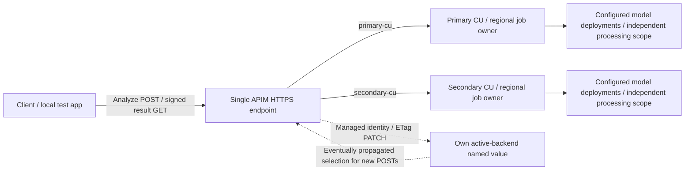

# High availability and disaster recovery for Content Understanding

> [!NOTE]
> **Work in progress (WIP).** These guides and the example lab are under active development. Details may change or be incomplete. Use them for learning and experimentation, not as production-ready guidance.

Build a highly available Azure Content Understanding (CU) system by designing for each of its dependencies: the regional CU service, model inference, OCR and layout processing, and your application's ingress. This walkthrough explains those boundaries, then provides a deployable multi-region example using Azure API Management (APIM).

## Understand the service boundaries

**A CU job belongs to a regional resource.** The resource that accepts an Analyze request tracks that job and serves its results. Content Understanding stores customer data at rest in the same region as the CU resource. Input documents, intermediate representations and final results are retained for **up to 24 hours**, then automatically deleted; the Delete Result API can delete them earlier. This regional storage boundary helps you choose where job data resides. It is not a durable application archive or a guarantee that every processing step stays in that region.

**Extraction depends on separately configured processing services.** CU uses OCR/layout processing and, for field extraction, your configured language models, including Azure OpenAI models in Microsoft Foundry. Their processing scopes are independent of CU job storage. A supported Data Zone or Global configuration can access processing capacity beyond a single region, but it does not move the CU resource, replicate accepted jobs or eliminate the model endpoint's own availability dependency.

| Concern | Configuration | What it controls |
|---|---|---|
| CU job ownership and storage | CU resource region | Where the job is tracked and its data is stored at rest. Poll its accepting resource. |
| Model inference | Model **deployment type**, such as Data Zone Standard (`DataZoneStandard`) or Global Standard (`GlobalStandard`) | The eligible processing scope for that model. It is not a CU Analyze location parameter. |
| OCR/layout processing | **`processingLocation`**: `geography`, `dataZone` or `global` | Processing scope for supported `prebuilt-read` and `prebuilt-layout` requests. Don't assume every extraction analyzer supports this control. |
| Result retrieval | **`Operation-Location`** response header | The URL to poll for one accepted job, not a model/OCR processing-location setting. |

Regional resource placement, data at rest and processing location are different decisions. Even model deployment types described as regional can process within the documented Azure geography rather than exclusively in the resource's region. Check the [CU data handling and retention documentation](https://learn.microsoft.com/azure/foundry/responsible-ai/content-understanding/data-privacy) and [Foundry model deployment types](https://learn.microsoft.com/azure/foundry/foundry-models/concepts/deployment-types) against your residency requirements.

## Walk through the architecture

Open the [interactive architecture guide](https://jfilcik.github.io/content-understanding-availability-patterns/) and work through five design steps:

1. **Start with a regional CU resource.** Identify the job owner, result storage, OCR/layout and model dependencies.
2. **Broaden model processing scope.** Compare a geography-based model deployment with supported Data Zone or Global deployments. CU and its regional OCR endpoint remain in place.
3. **Broaden OCR processing scope separately.** Keep the model configuration from step 2 and compare supported OCR `processingLocation` choices. The two controls are independent.
4. **Fail over new work between CU regions.** Put two prepared CU resources behind one APIM and preserve each accepted job's original result destination.
5. **Address gateway-region failure.** Consider separate regional gateways and resilient ingress. This extension is not deployed by the sample.

Then open the [single-APIM failover walkthrough](https://jfilcik.github.io/content-understanding-availability-patterns/single-apim-failover.html) for request routing, signed `Operation-Location` URLs, detection and recovery. The guides require no credentials. Download both HTML files together to view them locally.

| Part | What it does | Requires Azure? |
|---|---|---|
| [Architecture guide](https://jfilcik.github.io/content-understanding-availability-patterns/) | Explains regional job ownership, model processing, OCR processing, CU failover and resilient ingress in five steps. | No |
| [APIM walkthrough](https://jfilcik.github.io/content-understanding-availability-patterns/single-apim-failover.html) | Animates Analyze, signed `Operation-Location` rewriting, region-pinned GETs and the failover state changes. | No |
| Bicep, policies and deployment scripts | Deploy and provision **one regional APIM and two regional CU/Foundry stacks**, corresponding to step 4 of the guide. | Yes |
| [CU Observatory](test-app/README.md) | Submits real analyses, inspects requests and runs explicit failover/reset experiments against your deployment. | Yes, for analysis and management controls |

This repository is an architecture walkthrough and sample implementation, not an Azure service availability guarantee. It doesn't deploy step 5's second APIM or ingress, or automatically change OCR processing scope. The model deployment SKU defaults to `GlobalStandard`; choose a supported alternative before deployment if needed. Review the [recovery design](#plan-for-disaster-recovery) and [implementation limits](#deliberate-limits) before adapting the sample.

## Plan for disaster recovery

High availability keeps new work flowing during degradation. Disaster recovery also needs a plan for accepted work, retained inputs and results, configuration, and restoration after an outage.

- Set application **recovery time objective (RTO)** and **recovery point objective (RPO)** targets. Measure recovery, including detection, APIM configuration propagation and any ingress/DNS delay; this sample promises no fixed recovery time.
- Keep source documents and completed results in application-owned durable storage with your required residency, retention and recovery controls. CU's up-to-24-hour retention is not a backup.
- Track the application request ID, accepting CU resource, complete polling URL and completion state securely. An accepted operation does not move to a second CU resource.
- Prepare matching analyzers, model mappings, permissions, networking and sufficient capacity in the secondary before an incident. Two CU resources can still share a processing dependency; model placement and deployment type need their own review.
- Define how to handle an unavailable or uncertain operation. Resubmission creates a new job, can duplicate processing and cost, and needs application-level reconciliation. The sample never replays a POST automatically.
- Exercise failover and explicit failback, including primary-region result unavailability. Backend switching alone is not disaster recovery for the entire application.

## Start here

1. Clone the repository, or download and extract its ZIP. Run subsequent commands from the repository root:

   ```powershell
   git clone https://github.com/jfilcik/content-understanding-availability-patterns.git
   Set-Location content-understanding-availability-patterns
   ```

2. Open the [architecture guide](https://jfilcik.github.io/content-understanding-availability-patterns/), or open `README.html` locally. Select a design step, read its trade-offs and follow the request flow. Use the [single-APIM walkthrough](https://jfilcik.github.io/content-understanding-availability-patterns/single-apim-failover.html) to examine the three operating states and URL mappings.
3. To try real traffic, [prepare and deploy the Azure lab](#deploy), then [start CU Observatory](#local-test-web-app). Expect charges for APIM, model deployments, telemetry and CU usage; use a dedicated test resource group.
4. In Observatory, add the APIM serving key, submit one analysis and select its POST/result GET rows. Compare the returned `Operation-Location`, accepting CU and new-work selection. Follow the [failover exercise](test-app/README.md#try-the-lab-in-order) before changing settings.

**Viewing HTML on GitHub:** The repository file viewer displays HTML source; it does not run the animations. Use the hosted guide links above, or download both HTML files together and open them locally. GitHub Pages hosts only the teaching guides, not the Azure control helper or live lab. To publish your own fork, follow the [GitHub Pages setup](#publish-the-html-guides-with-github-pages).

## Deployed architecture

The step-4 implementation uses one Azure API Management instance to select between two prepared regional CU/Foundry stacks. New submissions use a persistent active-backend setting; signed result URLs keep polling the exact accepting CU resource through **the same APIM hostname**. Each CU resource retains its own job data. The template creates model deployments in each resource's region, but their deployment type determines processing scope; `GlobalStandard` does not restrict inference to that region. There is no Traffic Manager, DNS workaround, Front Door, runtime analyzer replication, Function App, queue or external routing-state service in the active deployment.



## Submission, affinity, and failover

1. Submit `POST /contentunderstanding/analyzers/{id}:analyze` or `:analyzeBinary` to the deployment's `contentUnderstandingUrl`.
2. APIM sends it once to the configured `primary-cu` or `secondary-cu` backend. A `202` returns a signed `Operation-Location` on that same APIM's default HTTPS hostname.
3. Poll **that complete, unchanged URL**, with the same APIM subscription. Its opaque `gateway-token` binds operation, subscription, accepting region, gateway, API version and original submission timestamp. APIM validates it and chooses the corresponding concrete CU backend, independently of current new-work selection.
4. On a primary result GET, APIM measures **original POST arrival → this result response**. `Succeeded` **strictly beyond 60 seconds** requests a switch to secondary for new work. `Running` / `NotStarted` beyond the same threshold also qualifies, so a stuck operation need not finish before detection. Exactly 60 seconds, terminal `Failed` / `Canceled`, and polls from the inactive backend do not trigger duration-based switching.
5. APIM reads its `active-backend` named value through ARM using managed identity, then conditionally PATCHes only that value with the read ETag. Its management role is scoped to that named-value child resource. The original CU response is preserved; management failures have explicit response/trace outcomes.
6. Once the configuration propagates, new POSTs use secondary. **Selection stays secondary until an explicit primary reset.** There is no cooldown, automatic failback or reverse failover.

The threshold is a deployment parameter. The signed timestamp is APIM's receipt of the original POST, and elapsed time ends when APIM processes each real result GET response. On success this is the **observed POST-to-success duration**; while pending it is a lower bound on completion time. This includes POST processing, time between polls and client pauses, not just CU engine time or the current GET's HTTP round trip. A delayed first successful poll can therefore trigger the duration policy even if CU finished earlier. Tune the threshold and polling cadence together. The browser cannot modify the signed start time.

There are **no `/health` or `/health/cu` APIs or synthetic health requests in the current sample**. Runtime observations come from real Analyze/result response headers: `X-CU-Elapsed-Seconds`, `X-CU-Latency-Threshold-Seconds`, `X-CU-Degradation-Reason`, `X-CU-Active-Backend` and `X-CU-Switch-Status`. An over-threshold result reports `completion-latency` or `pending-latency`; this is a per-operation degradation signal, not proof of a regional outage.

Primary submission `429`, backend `5xx` and forwarding failures also request secondary selection. The original failure is returned; **no POST is automatically replayed**. A timeout can hide an already accepted operation. A malformed document or terminal `Failed` job is not automatically a regional outage.

### Why this is not a Retry-After trigger

Direct live tests of CU API `2025-11-01` completed analyses in both configured regions. A real secondary `HTTP 200 / Running` result GET had **no Retry-After or other retry-named header**. Neither region's observed acceptance or terminal responses had one. The primary's first GET was already successful, so these tests do not establish its pending-response behavior.

The [CU result API](https://learn.microsoft.com/en-us/rest/api/contentunderstanding/content-analyzers/get-result?view=rest-contentunderstanding-2025-11-01) returns a status body and does not promise a pending Retry-After header. Unlike a Document Intelligence header-presence sample, this implementation uses **real pending/successful status plus signed POST-to-result elapsed time**. It does not manufacture Retry-After on successful CU responses. The client still honors a real Retry-After for polling cadence if present; header presence alone never establishes an outage.

### Live verification

On 2026-10-22 UTC, the final real-browser verification completed four invoice analyses through one APIM: a primary baseline, two deliberate primary test submissions, and new secondary work. A fast completed test job did not trigger failover. With the UI's temporary 2-second threshold, APIM observed an actual primary `200 / Running` at a signed age of **4.177 seconds** and reported `accepted-awaiting-activation`. After runtime activation, a new analysis completed in West Europe through the **same hostname**. The original Sweden Central operation completed, and its signed GET still reached Sweden Central after the switch; that terminal poll did not undo secondary selection.

Neither region's observed pending response supplied Retry-After. The test restored the 60-second threshold and explicitly reset primary, with no outstanding restoration leases; the retained signing and serving credentials were unchanged. This proves the pending-age failover path with real CU responses, not a simulated regional outage or a guarantee of a switch within two seconds.

That live verification predates the added slow-success trigger and removal of routing-status probes. Local policy tests cover both pending and successful threshold boundaries; they are not evidence that the updated policy has been deployed or live-verified.

### Deliberate limits

- **One regional APIM remains a dependency.** This handles CU backend failure, not loss of the gateway's region. Multi-region gateways require a separate ingress design.
- **Client polling drives duration detection.** No polls means no POST-to-result observations. Polling gaps increase observed duration; the measurement is not pure CU processing time.
- **ARM availability and propagation matter.** Accepted PATCH is not gateway activation. A previous analysis response or management read can differ from the next request's runtime configuration. An actual accepted secondary analysis proves that request used secondary.
- **No synthetic health checks.** An operation exceeding the threshold is the degradation signal. Local management reads report settings, not CU availability, capacity or recovery.
- **No shared native circuit breaker or pool.** A breaker must not block retrieval of previously accepted jobs. The secondary is not independently health-qualified, and there is no automatic switch back if it fails.
- **An existing job does not move.** Losing its accepting CU can make its result unavailable even while new work succeeds elsewhere. Deliberate resubmission creates a new job and can duplicate cost; a client timeout is not cancellation.
- This is a small-workload example with a single region-wide latency threshold. Large documents and different analyzers can have different normal completion times.

## Analyzer definitions

The `analyzers` folder is the source of truth for the deployment-managed analyzer set. To add an analyzer, add its JSON definition and rerun deployment. The deployment tooling creates/replaces the listed definitions in **both** CU resources and waits for readiness.

- No copy APIs, timers, timestamp comparison, or delete propagation.
- Removing a definition from the folder does **not** delete an existing analyzer.
- Deployment validates analyzer IDs, model roles and custom base-analyzer dependencies before writes.
- Both regions must support the configured models, model mappings, SKU, and capacity. CU's model defaults are configured as part of provisioning; an ARM connection alone is not treated as sufficient.
- Fresh CU resources return `DefaultsNotSet` if defaults are read before configuration. Provisioning checks regional prebuilt model support first, then writes defaults and verifies them before creating custom analyzers.
- Deployment is idempotent, but it is **not an atomic transaction across regions**. On a failure, fix the cause and rerun it.
- New submissions stay gated by the `analyzers-ready` APIM named value until provisioning succeeds in both regions. Infrastructure redeployment resets that gate; it is not a zero-downtime analyzer-version rollout. Existing signed polling URLs remain usable.

The serving gateway exposes only Analyze, AnalyzeBinary and result GET. Analyzer create/update/delete is a deployment operation, not a public gateway route.

## Deploy

Prerequisites:

- An Azure subscription and a dedicated, existing test resource group.
- Azure CLI and Bicep CLI (`az bicep install` if missing).
- Python 3.10+ for deployment tooling. Azure Functions Core Tools and Azure SDK packages are not needed.
- An authenticated deployment identity with permission to deploy resources, assign roles, read/preserve APIM secrets, and configure CU analyzers/model defaults.
- Two different regions supporting the configured models and sufficient quota.
- Public endpoint access, or the private endpoints, DNS and network reachability appropriate for your configuration. Disabling public access does not provision that networking automatically.

The template defaults to **Standard v2 APIM**, two Foundry accounts with completion/embedding deployments, and shared monitoring. Resources can incur charges even when no document is being analyzed. Model availability, quota and price vary by region and subscription; confirm them before deploying. Node.js and .NET are needed only for their respective local tests, not to run the lab.

### Sign in and prepare a test resource group

Use PowerShell 7 or a Bash shell with the tools above. Sign in and explicitly select the subscription before running either deployment wrapper:

```powershell
az login
az account set --subscription <subscription-id>
az account show --query "{subscription:name,id:id}" --output table
az group create --name <test-resource-group> --location swedencentral
```

The resource group's metadata location does not choose CU/APIM placement; edit the two deployment regions in the next step. If your test group already exists, use it instead of creating another one. An administrator must grant the deployment identity the required resource-management, role-assignment and CU data-plane access. Subscription Contributor alone cannot assign roles.

### Choose regions before deploying

The sample defaults to **Sweden Central** (`swedencentral`) for APIM and primary CU, and **West Europe** (`westeurope`) for secondary CU. These are defaults, not required customer locations. Choose two different regions that support Content Understanding, the selected completion/embedding models, deployment SKU and sufficient quota.

Copy the example once, then open the ignored local file in your editor:

```powershell
Copy-Item .\main.example.bicepparam .\main.bicepparam
```

Set `publisherEmail` / `publisherName` to your APIM publisher contact details, review both model names/versions/SKUs and capacities for your subscription, then edit these two lines **before your first deployment**:

```bicep
param primaryLocation = 'swedencentral' // APIM and primary CU
param secondaryLocation = 'westeurope' // Secondary CU
```

Use Azure location IDs, not display names. Changing these parameters changes where the regional resources are created; it is not a failover control or an in-place move of an existing resource. Use a new resource group for a different regional deployment. The local lab reads the chosen locations from deployment outputs; the architecture guide uses the default regions for its examples. Set `modelDeploymentSkuName` and `embeddingDeploymentSkuName` separately from resource placement. Their `GlobalStandard` defaults permit global model processing; selecting another region alone doesn't narrow that scope.

Fresh Foundry resources use compact names such as `foundry-swc-abc123` and `foundry-weu-def456`. This sample uses `swc` for Sweden Central and `weu` for West Europe as **naming codes**, not Azure location IDs. A deterministic six-character suffix reduces global-name collisions. Other regions default to their full location ID in the name; optionally set `primaryRegionCode` / `secondaryRegionCode` to your organization's short codes. Codes affect naming only, not placement. You can also override `primaryFoundryName` / `secondaryFoundryName` if a name is unavailable.

Existing resources are **not renamed**: the deployment scripts preserve the Foundry account names recorded in existing deployment outputs and reject conflicting overrides. If a failed/older deployment has no Foundry identity outputs, explicitly set both existing Foundry names in `main.bicepparam` before retrying; do not let the new defaults create replacement stacks. Renaming an Azure account is not an in-place operation and would change its endpoint, breaking outstanding polling affinity.

### Run deployment

After saving `main.bicepparam`, validate first and review what-if before deploying. Do not copy the example over an already customized file:

```powershell
.\scripts\deploy.ps1 -ResourceGroupName <test-resource-group> -SubscriptionId <subscription-id> -ValidateOnly
.\scripts\deploy.ps1 -ResourceGroupName <test-resource-group> -SubscriptionId <subscription-id>
```

On Bash:

```bash
bash scripts/deploy.sh --resource-group <test-resource-group> --subscription-id <subscription-id> --validate-only
bash scripts/deploy.sh --resource-group <test-resource-group> --subscription-id <subscription-id>
```

Successful deployment reports that infrastructure and the listed analyzers are ready in both regions and that the gateway provisioning gate is open. The resource-group deployment is named `cu-regional-ha`; the connected helper uses that deployment's outputs to configure the lab. Do not submit analyses after a partial deployment: correct the reported error and rerun the wrapper.

Use the provided scripts rather than a raw ARM deployment. They preserve the retained APIM's signing secret, serving key pair and current backend selection, generating credentials only for a new installation. Real keys are not examples or deployment outputs. Empty secret defaults support compilation/validation, not runnable authentication.

If an initial deployment fails before outputs are recorded, set `primaryApimName` to the retained gateway in your ignored parameter file. Recovery inventories resources and reads existing credentials rather than guessing names or rotating keys.

The deployment identity's direct/inherited CU role is checked by object ID without Microsoft Graph name resolution. Group-membership lookup is needed only if those assignments do not establish the required role.

`ValidateOnly` performs local definition validation, an effective IAM permission check at the target resource group, and Azure infrastructure validation/what-if, without provisioning analyzers or creating/retrieving credentials. The script stops before reading secrets or creating billable resources if the identity lacks `Microsoft.Authorization/roleAssignments/write`, even if ARM validation alone would succeed. Contributor alone is insufficient; an administrator must grant suitable group-scoped IAM rights, such as Role Based Access Control Administrator. It is not a CU data-plane readiness test.

Validation-only mode also skips identity recovery from deployment history. For an existing stack, explicitly supply its retained `primaryApimName`, `primaryFoundryName` and `secondaryFoundryName` so the what-if reflects those resources instead of fresh-install naming defaults.

APIM's managed identity receives CU data access in both regions, plus API Management Service Contributor scoped only to its own `active-backend` named value. Foundry uses its local model identity. CU key authentication remains disabled. Clients use an **APIM** subscription key, not a CU key.

### One HTTPS entry point

APIM's default `*.azure-api.net` certificate works for submissions and both backends' result URLs. No customer hostname, local DNS resolver or TLS workaround is needed. Outputs include `contentUnderstandingUrl`, `gatewayResourceId`, both CU region/endpoint/resource identities and model names. Traffic Manager, a second APIM and a synthetic health API are not deployed.

## Local test web app

The `test-app` folder is a local request lab: a collapsible serving-key prerequisite with Azure portal instructions at the top, followed by document submission. A Fiddler-style network trace on the left defaults to analysis and polling; the right pane opens on **Routes & resources**, followed by **Request inspector**, with request-specific highlighting. Drag the divider to resize the panes. Operations remain below both panes. It defaults to the [Azure Samples invoice](https://github.com/Azure-Samples/azure-ai-content-understanding-python/raw/refs/heads/main/data/invoice.pdf). Analysis and result polling go **directly from the browser to APIM**.

Start the loopback helper without Azure controls:

```powershell
python .\scripts\serve_observatory.py
```

Or enable real temporary controls for an explicitly selected test deployment, using your current `az login` identity:

```powershell
python .\scripts\serve_observatory.py --enable-azure-controls `
  --subscription <subscription-id> --resource-group <test-resource-group>
```

Open `http://127.0.0.1:5173`. Control mode discovers nonsecret configuration from the successful `cu-regional-ha` deployment. The helper refreshes management settings for control safety/restoration; the browser sends no periodic APIM health requests. Otherwise configure/import one APIM URL and both CU identities. Enter the serving key separately; it never goes to the helper. No Azure hosting is created.

For the shortest end-to-end exercise:

1. In the app's top prerequisite section, follow the Azure portal link. Under **APIs > Subscriptions > Content Understanding client**, reveal the APIM **Primary key**, paste it into the app and select **Use key for this tab**. This is an APIM serving key, not a CU key or Azure CLI token.
2. Leave the sample invoice and `invoice` analyzer selected, then select **Submit one analysis**. Each deliberate submit can incur CU/model usage charges.
3. Select its POST in the trace and open **Request inspector**. Inspect the ID, status and rewritten `Operation-Location`; expand **API Management** under **Routes & resources** for the before/after URL mappings.
4. Follow the bounded [failover and recovery exercise](test-app/README.md#try-the-lab-in-order). Restore the threshold and reset primary separately before finishing.

The diagram shows one APIM and two CU resources, highlighting each request's actual accepting backend separately from the last response's new-work selection. Before an analysis is submitted or polled, runtime state is explicitly unobserved; management configuration is shown separately.

The key and jobs stay in memory; reloading loses them. The app validates returned polling destinations before attaching the key and does not silently retry a submission.

Inspect each POST, result GET and control action in the trace. CU hops are configured/gateway-reported topology, not invented browser network captures. The hostname cannot identify the accepting CU; response metadata and the signed URL do. Operations show gateway POST-to-result duration, with the final successful duration distinguished from client age and individual request RTT.

The inspector highlights the CU operation ID, the selected response's CU status and its returned `Operation-Location`. The token placeholder shows **`[accepting Foundry resource name] hover for details`**, using the observed accepting backend and matching deployment metadata, not unverified token claims. Without resource metadata it shows the known backend/region, not a guessed resource name. This is a display label, not part of the URL sent. Hover, focus or tap it for the complete token and locally decoded routing claims; Escape or **Hide token** dismisses it. This is **Base64 decoding, not decryption**: the browser does not have the HMAC secret and cannot verify the signature. Gateway-reported backend, observed accepting backend and that response's active new-work selection are shown separately from unverified token claims. Normal trace/JSON views remain redacted.

Expand **API Management** to see selected-request URL mappings: Analyze POST to configured CU, CU result URL to returned APIM `Operation-Location`, and signed APIM GET to the accepting CU with `gateway-token` removed. Backend URLs are explicitly configuration-derived illustrations, not captured backend traffic; without matching helper metadata, the view shows symbolic backend identities instead of guessing hostnames.

**Test failover · 2s** temporarily lowers the gateway threshold, with automatic restoration (5 minutes by default) and restore-now. Submit to primary and keep polling; inspect actual response headers for the runtime threshold. A real pending or successful result GET with POST-to-result duration strictly beyond 2 seconds qualifies; this does not guarantee a two-second switch.

**Reset to primary**, next to **Test failover · 2s**, manually selects primary for new submissions using the same guarded control as the APIM card. It does not move jobs or restore the threshold; restore the threshold separately to avoid an immediate re-trigger from overdue primary polling. Wait for configuration propagation and inspect new submissions before treating reset as activated. Management selection and gateway runtime selection are shown separately.

Expand APIM for editable temporary thresholds, **Select secondary manually** and the same **Reset to primary** control. Manual steering is explicitly not automatic-failover evidence. **Threshold restoration never resets active selection**, and resetting selection never restores the threshold.

Threshold overrides last 3, 5 or 10 minutes and are journaled before mutation. Keep the helper running until restoration is confirmed; restart restores owned overrides, including unexpired ones. ETag conflicts and outside edits are surfaced, not overwritten. See [the app guide](test-app/README.md) for permissions and safeguards.

Do not mistake browser delays for pure CU processing time: the gateway measures POST-to-result observations, which include polling gaps. Automated network tests are mocks, not evidence of live failover.

`allowedBrowserOrigins` controls exact localhost CORS origins. Readable headers include Operation-Location, Retry-After, X-CU-Region, X-CU-Gateway, X-CU-Elapsed-Seconds, X-CU-Latency-Threshold-Seconds, X-CU-Degradation-Reason, X-CU-Backend, X-CU-Active-Backend, X-CU-Switch-Status and X-CU-Trigger. Do not replace the allowlist with `*`.

Browser fetch errors sometimes hide whether a failure is CORS, TLS or network related. Check the browser network console and APIM diagnostics rather than labeling every opaque error as CU failure.
Missing/invalid serving keys return HTTP 401 with allowlisted CORS, even before inbound evaluation; these failures do not switch CU.

### Troubleshooting and ending a session

| Symptom | Next action |
|---|---|
| **Submit one analysis** is disabled | Confirm the connection is configured and add the serving key. No synthetic health check is required. |
| No automatic connection configuration | Start the helper with `--enable-azure-controls`, the correct subscription/group and a successful `cu-regional-ha` deployment. Otherwise use [manual connection configuration](test-app/README.md#manual-connection-configuration). |
| `503 / GatewayNotConfigured` | Finish deployment-managed provisioning in both regions. Do not repeatedly resubmit or bypass the provisioning gate. |
| Deployment fails on permission, model availability or quota | Read the reported error, correct access or parameters, then rerun validation and deployment. A successful Bicep build alone does not establish quota or data-plane permissions. |
| Browser reports an opaque network/CORS error | Use the exact allowed origin (`http://127.0.0.1:5173` by default) and inspect browser/APIM diagnostics. Do not broaden CORS to `*` or assume CU is down. |
| Management says secondary but an analysis still reports primary | Allow policy propagation. Inspect a new real response; management acceptance is not proof of runtime activation. |
| Old result GETs still go to primary after failover | This is expected affinity. A previously accepted operation does not move to the secondary CU resource. |

Before stopping the helper, select **Restore test threshold**, confirm restoration, then **Reset to primary** if desired. Keep it running until any restoration lease is cleared. Closing the browser loses in-memory keys/jobs but does not cancel CU work or reset Azure settings. Retain any complete polling URLs privately before reloading.

Stopping the helper does not stop Azure charges. When finished with a **dedicated disposable** lab, remove its resources through Azure portal or your approved resource-group cleanup procedure after confirming no unrelated resources or needed jobs remain. Do not delete a shared resource group or an unresolved restoration journal.

## Publish the HTML guides with GitHub Pages

No HTML build framework, npm install or Azure deployment is needed for the teaching pages. The included `.github/workflows/pages.yml` stages an explicit allowlist: the architecture guide as `index.html` and `README.html`, plus `single-apim-failover.html`. It does **not** publish the repository root, local parameters, `.azure` state, serving keys, test results or the live app. Documentation links in the published copies point back to the source repository.

After merging the initial PR:

1. In the repository, open **Settings > Pages**. Under **Build and deployment > Source**, select **GitHub Actions**.
2. Under **Settings > Secrets and variables > Actions > Variables**, create the repository variable **`PUBLISH_TEACHING_GUIDES`** with value **`true`**. No Azure or serving-key secrets are needed.
3. Under **Actions**, select **Publish teaching guides**, then **Run workflow** on `main`. Later guide changes on `main` publish automatically while the variable remains `true`. PRs never deploy a Pages site.
4. Open the URL reported by the workflow's `github-pages` environment or **Settings > Pages**. It ends in `/content-understanding-availability-patterns/`; the root opens the architecture guide and its link opens the APIM walkthrough.

Publishing is off by default. GitHub Free requires a public repository for Pages; private-repository support depends on your plan. **A Pages site can be public even when the repository is private.** Review the content and visibility before enabling it. See [Creating a GitHub Pages site](https://docs.github.com/en/pages/getting-started-with-github-pages/creating-a-github-pages-site).

To preview the exact site artifact locally, without enabling Pages:

```powershell
python .\scripts\build_site.py --repository jfilcik/content-understanding-availability-patterns --ref main
python -m http.server 5180 --bind 127.0.0.1 --directory .\_site
```

Open `http://127.0.0.1:5180`. Stop this static preview with Ctrl+C. Unlike the real lab helper, it has no Azure controls and makes no CU requests.

## Diagnostics

The gateway has Application Insights and Log Analytics. `cu-observation` records region, operation correlation, analyzer, status and elapsed time. `cu-routing` records acceptance and switch outcomes, including management failure/conflict. Request/response bodies and credential headers are not logged; gateway-token/subscription-key query parameters are masked.

In Application Insights Logs, derive the **first observed** successful completion per operation before calculating percentiles:

```kql
traces
| where timestamp > ago(1d) and message == "operation-observed"
| extend Region = tostring(customDimensions.region),
         Operation = tostring(customDimensions.operation),
         Status = tostring(customDimensions.status),
         Seconds = todouble(customDimensions.elapsedSeconds)
| where Status == "succeeded"
| summarize ObservedSeconds = min(Seconds) by Region, Operation
| summarize Jobs = count(), P50 = percentile(ObservedSeconds, 50),
            P95 = percentile(ObservedSeconds, 95) by Region
```

```kql
traces
| where timestamp > ago(1d)
| where message in ("accepted-awaiting-activation", "already-secondary", "read-failed", "write-failed", "write-outcome-unknown", "conflict", "submission-accepted")
| project timestamp, message, Region = tostring(customDimensions.region),
          Reason = tostring(customDimensions.reason)
| order by timestamp desc
```

Telemetry is not the routing state store. No Log Analytics query runs on the request path. Restrict diagnostic access and avoid adding body logging or logging complete signed polling URLs.

## Migrating an existing deployment

**Incremental deployment does not delete omitted resources or revoke old role assignments.** Keep obsolete resources until validation and old-operation drainage are complete.

The current template no longer defines the old APIM API named `health`; updating the app stops its `/health/cu` requests without changing Azure resources. An existing deployed health API remains until explicitly removed, because incremental deployment does not delete it. It has no role in Analyze/result routing. Old browser tabs retain their old code and may continue polling until their auto-refresh is disabled or the tab is closed; preserve in-memory jobs and full polling URLs before any reload.

Before switching production:

1. Preserve the retained primary gateway name, signing key and serving key pair. Its previously signed primary URLs remain valid. Old secondary-APIM URLs must drain on that old APIM; do not rewrite or replay them.
2. Restore old helper overrides and stop the old TM-aware helper before retiring Traffic Manager. Stop any legacy analyzer-replication controllers before deployment-managed provisioning.
3. Review what-if and deploy/provision both CU resources. Existing active selection is preserved across redeployments.
4. Prove primary success, actual overdue pending detection, automatic secondary acceptance through the **same hostname**, original primary completion, and explicit reset. Management success alone is insufficient.
5. Only after drainage and explicit approval, delete the specific obsolete secondary APIM and Traffic Manager. Retain both CU/model stacks and telemetry. Remove obsolete backends/wildcard operations and grants only after their traffic drains. Never delete a whole resource group or use complete mode.

### Secret rotation

Ordinary deployment preserves secrets. The signing key is independent of the serving key and never given to clients. Changing it invalidates outstanding tokens; drain first. Rotate the APIM serving pair by moving clients to the still-valid key before replacing the unused one.

## Local validation

```powershell
python -m unittest discover -s .\tests -v
az bicep build-params --file .\main.example.bicepparam --stdout | Out-Null
dotnet run --project .\tests\policies\PolicyTests.csproj
```

The .NET 8 harness compiles/executes expressions from the real XML, including threshold boundaries, signed dual-backend affinity, sticky selection, ETag conflicts and management-failure response preservation. It is **not** a substitute for APIM runtime validation.

For the static app, Node.js 22+ runs the dependency-free unit tests:

```powershell
npm --prefix .\test-app test
```

Browser tests additionally require Python 3, Google Chrome, and a free port 5174 (override with `CU_OBSERVATORY_TEST_PORT`). Install the app's development dependencies once with `npm --prefix .\test-app ci`, then run `npm --prefix .\test-app run test:browser`. For Microsoft Edge, set `$env:PLAYWRIGHT_CHANNEL = 'msedge'`. The browser suite starts and stops its own local server with Azure controls disabled and uses mocked API responses; it does not submit Azure jobs or change Azure settings.

Before production, verify actual APIM policy acceptance, scoped management access, propagation, CORS/errors, CU provisioning, same-host automatic switching and pinned results. Tune thresholds to representative documents and separately address the gateway-region dependency. Azure tests create usage and require authorization.

## Attribution and license

This sample builds on [p-prakash/multi-region-ha-acu](https://github.com/p-prakash/multi-region-ha-acu). The original MIT license and copyright notice are retained in [LICENSE](LICENSE). The architecture guides and lab are examples, not an Azure service SLA or a commitment that every conceptual stage is implemented here.

The guides use the GitHub mark from [Primer Octicons](https://github.com/primer/octicons), under its [MIT license](https://github.com/primer/octicons/blob/main/LICENSE). Its license notice is embedded in both HTML files.
